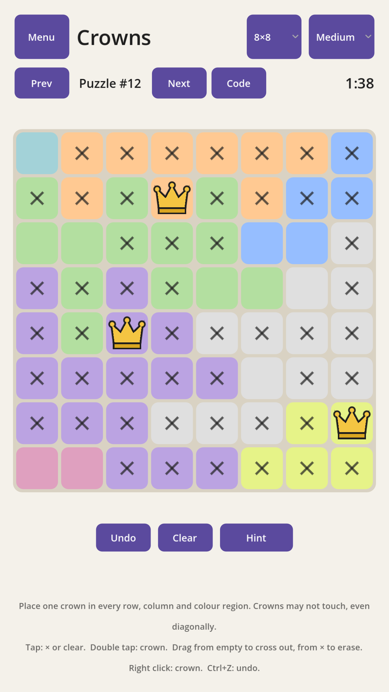
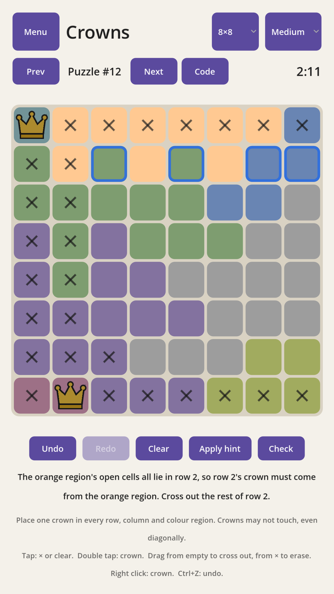
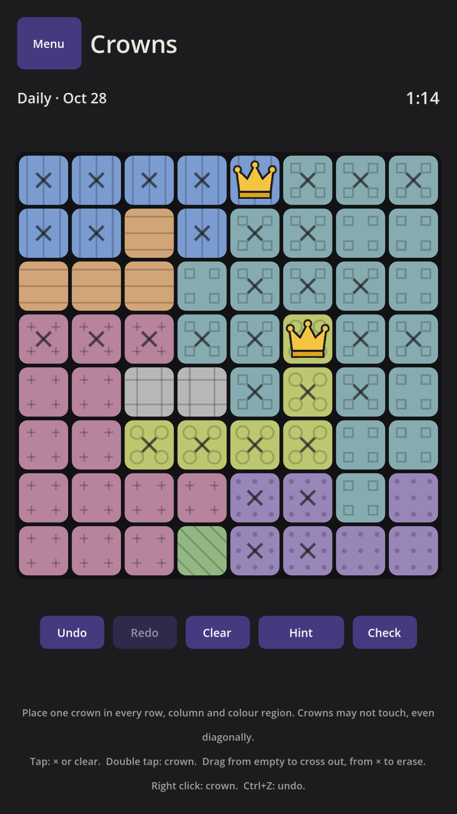

# Crowns

A logic puzzle game. Place one crown in every row, every column and every coloured
region, with no two crowns touching, not even diagonally. Every puzzle has exactly
one solution and can be solved by reasoning alone, without guessing.

<p align="center">
  
  
  
</p>

**Play it:** [itch.io](https://ascteroido.itch.io/crowns) (in the browser, or for Linux,
Windows and Android) · [GitHub releases](https://github.com/ascteroido/Crowns/releases)

## Features

- Puzzles from 5×5 to 14×14, graded Easy, Medium, Hard and Hard+
- A daily puzzle with streaks and an archive, and a weekly challenge
- The Climb (one life, no hints), speed runs and technique drills
- Hints that explain the next deduction, rather than just placing a crown
- A puzzle editor, and puzzle codes to share any board
- An interactive tutorial, stats, a solve history and a calendar of days played
- Leaderboards and achievements (Google Play Games, or SilentWolf elsewhere)
- Themes and custom colours, text sizes, region patterns for colour blindness,
  and an option to turn off animations
- Touch, mouse, keyboard and gamepad controls, in portrait and landscape
- Translations, including right-to-left languages
- No ads, no tracking

## Building

Crowns is made with [Godot](https://godotengine.org) **4.7.2**. Open the folder in the
Godot editor and press Play, or run it from a terminal:

```
godot --path .
```

To export, install Godot's export templates, then use the presets in
`export_presets.cfg`:

| Preset | Output |
| --- | --- |
| Linux | `build/linux/Crowns.x86_64` |
| Windows | `build/windows/Crowns.exe` |
| Web | `build/web/index.html` (serve it over HTTP; it doesn't run from a file) |
| Android | `build/crowns.aab`, the Google Play build, with Play Games |
| Android SilentWolf | `build/crowns-silentwolf.apk`, without any Google services |

```
godot --headless --path . --export-release Linux build/linux/Crowns.x86_64
```

The Android presets use Godot's Gradle build, so they also need the Android SDK and
an Android build template (*Project → Install Android Build Template*). Release builds
need your own signing key. `addons/DailyReminder/build.sh` rebuilds the reminder and
icon plugin's `.aar` from its Java source in `addons/DailyReminder/android/`.

**Online leaderboards** outside Google Play use [SilentWolf](https://silentwolf.com).
The key isn't in the repository: without it the game runs offline. To use your own,
create `scripts/silent_wolf_key.gd`:

```gdscript
const GAME_ID := "YourGameId"
const API_KEY := "your-api-key"
```

## Tests

```
godot --headless --audio-driver Dummy --path . --script res://tests/ui_test.gd
godot --headless --path . --script res://tests/generator_test.gd
```

Each prints `FAILURES: 0` when everything passes.

## Translating

Translations are gettext `.po` files in [`translations/`](translations/). See
[translations/README.md](translations/README.md) for how to add a language. You only
need the template, not the whole game.

## Licence

The code is free software under the [GNU General Public License v3.0](LICENSE). The
artwork (the icon, achievement icons and store images) is
[CC BY-SA 4.0](https://creativecommons.org/licenses/by-sa/4.0/). Sounds and fonts are
by others, under their own licences: see [CREDITS.md](CREDITS.md), also shown in the
game under **Credits**.

[Privacy policy](https://ascteroido.github.io/Crowns/privacy.html)
